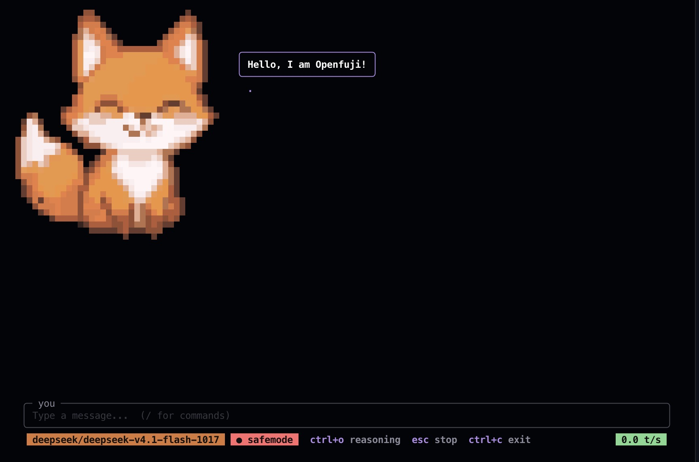

# Openfuji

A lightweight AI assistant that runs right inside your terminal. You chat with a little fox that can read and edit your files, run shell commands, and search the web using OpenRouter models.

## What it can do

- **File & code editing:** Reads files, creates new ones, edits or deletes specific lines, and searches across your project.
- **Web access:** Searches DuckDuckGo, reads text from web pages, and downloads files.
- **Safe mode:** Asks for your permission before changing files or running terminal commands. You can approve once, deny, or allow a tool for the current workspace.
- **Reasoning control:** Change reasoning effort (`none`, `minimal`, `low`, `medium`, `high`, `xhigh`) and press `Ctrl+O` to show or hide the model's thinking.
- **Chat logs & stats:** Saves your chats automatically so you can open old sessions later, plus shows a live tokens-per-second (`t/s`) counter.

## Setup

1. **Clone the repository**
   ```bash
   git clone https://github.com/Foxiified/Openfuji.git
   cd Openfuji
   ```

2. **Install the Python packages**
   ```bash
   pip install -r requirements.txt
   ```

3. **Install Chromium (needed for reading web pages)**
   ```bash
   playwright install chromium
   ```

4. **Start Openfuji**
   ```bash
   python3 main.py
   ```

5. **Add your API key**
   On the first run, Openfuji creates a `.env` file automatically. You can either paste your OpenRouter key inside `.env`:
   ```env
   OPENROUTER_API_KEY=sk-or-v1-...
   ```
   Or set it directly inside the app by typing `/settings`.

## Commands & Keys

- `/model` — Switch between available models
- `/settings` — Set your API key, custom base URL, or toggle the TPS counter
- `/reasoning` — Change the reasoning effort level
- `/safemode` — Toggle approval prompts on or off
- `/chat` — Load a previous chat log
- `/files` — View files generated in the current session
- `/clear` — Clear memory and start a new log
- `Ctrl+O` — Show or hide reasoning text
- `Esc` — Stop generation or close a menu
- `Ctrl+C` — Quit

---

Inspired by [@gentoolarp](https://www.tiktok.com/@gentoolarp/video/7707244893227207939).


v2 is coming.
